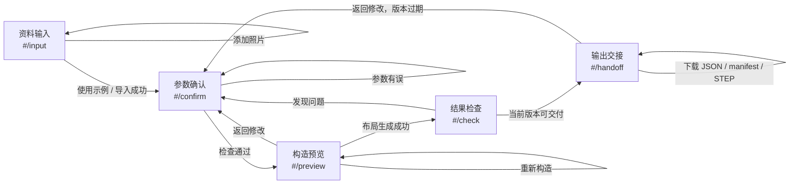

# aicad 产品流程基准

状态：页面流程基准 v0.1（2026-11-20）。本文把 aicad 从资料输入到 CAD 交接的链路固定为 5 个页面状态，用于统一文案、布局、跳转和模块职责。它描述产品层的工作台流程；具体视觉尺寸和组件样式在实现时以此为准。

## 全局框架

5 个状态可以采用独立路由，也可以在同一个工作台内以步骤面板呈现。无论采用哪种实现，顶部都保留步骤条、当前方案名称和版本号；主内容区承担当前任务，右侧显示来源、校验或交付状态。用户始终能看到“当前在哪一步、为什么能进入下一步、返回后哪些结果会失效”。

统一状态文案：`待输入`、`待确认`、`检查通过`、`需修正`、`可交付`、`环境受限`。照片识别或默认值必须带来源标签；用户确认或改写后更新为“已确认/手动修改”。参数发生变化时，旧预览和旧交付文件标记为“版本过期”，不得误认为当前结果。

## 页面 1：资料输入

**建议路径：** `#/input`

**页面文案**

- 标题：`先把现场资料放进来`
- 说明：`上传现场照片，或从示例、参数文件开始。照片用于对照，识别结果进入下一步后仍需确认。`
- 空状态：`还没有资料。可使用示例体验完整流程。`
- 主按钮：`继续确认参数`
- 次按钮：`使用示例`、`导入参数 JSON`

**布局**

顶部为 1–5 步骤条；中间为左右两栏。左栏是照片拖拽区和“添加照片”按钮，下方列出文件名、尺寸和删除操作；右栏是示例/JSON 导入卡片以及本次任务的资料清单。底部固定操作栏显示“继续确认参数”，没有任何可用资料时仍可用“使用示例”建立起点。

**信息传达重点**

这一页只说明资料是否进入系统、来源是什么，不提前把照片当成结论。用户需要知道：照片可以缺省，示例值只是体验数据，尺寸和型号仍要在下一页确认。

**点击与跳转**

- `使用示例`：载入 fixture，跳转 `#/confirm`。
- `导入参数 JSON`：读取成功后跳转 `#/confirm`；读取失败显示错误，不覆盖当前方案。
- `添加照片`：加入本地资料清单，停留当前页。
- `继续确认参数`：已有示例或 JSON 时跳转 `#/confirm`；无资料时提示先使用示例或导入文件。

**模块映射**

`web/index.html` 提供入口结构；`web/app.js` 管理照片、fixture 和 JSON 导入状态；`ui_server.py` 提供参数读取与校验接口；`core/vision_agent.py` 是可选的照片候选提取入口，不在此页直接给出确定结论。

## 页面 2：参数确认

**建议路径：** `#/confirm`

**页面文案**

- 标题：`确认货架参数`
- 说明：`先确认尺寸、排布和构件规格，再进入构造。带“候选”标签的值来自识别或默认值，需要你确认。`
- 辅助提示：`单位统一为 mm；每跨轴线宽度和单排轴线深度不是货架最大外轮廓。`
- 主按钮：`检查参数`
- 通过后按钮：`进入构造预览`

**布局**

左栏为分组表单：布局尺寸、排布、层数和构件尺寸；中栏为完整 JSON 编辑或字段详情；右栏为来源与待确认清单。字段旁显示“示例”“导入”“视觉候选”“手动修改”等来源标签。底部显示校验结果和下一步按钮，错误直接定位到字段。

**信息传达重点**

这一页是输入和构造之间的责任边界：系统可以提出候选参数，但只有用户确认后的参数才能成为构造依据。校验必须同时解释错误字段、单位和修正方向，不能只显示红色状态。

**点击与跳转**

- `检查参数`：调用校验；通过则标记“检查通过”，失败则停留当前页并定位错误。
- `进入构造预览`：仅在参数通过校验后跳转 `#/preview`。
- `返回资料输入`：跳转 `#/input`，保留当前草稿。
- 修改任一参数：清除当前预览/交付的可交付状态，并提示“结果将按新版本重算”。

**模块映射**

`web/app.js` 负责表单和 JSON 的双向同步；`ui_server.py` 接收并返回校验结果；`core/pipeline.py` 编排加载、校验与版本状态；`core/geometry_contract.py` 定义后续构造所依赖的 Layout 输入边界。

## 页面 3：构造预览

**建议路径：** `#/preview`

**页面文案**

- 标题：`核对方案构造`
- 说明：`预览依据当前已确认参数生成。旋转或切换视图，检查排数、跨数、层高、深度和斜撑分段。`
- 状态：`构造版本 v{version}`；若运行环境不可用，显示 `环境受限：无法生成当前几何`。
- 主按钮：`进入结果检查`
- 次按钮：`返回参数确认`

**布局**

中间为三维预览或布局画布，提供旋转、缩放和视图切换；左侧为“构造摘要”（排数、跨数、层数、总高、总深度）；右侧为假设和环境状态（层板厚度、起步高度、斜撑间距、未建模构件）。底部显示当前版本和“重新构造”操作。

**信息传达重点**

预览要回答“参数是否按预期构成空间关系”，不把视觉效果当成工程验收。画布、摘要和后续 manifest 必须来自同一份 Layout；环境阻塞需要解释原因并提供返回参数的路径。

**点击与跳转**

- `进入结果检查`：有布局结果时跳转 `#/check`；没有结果则提示先解决环境或参数问题。
- `返回参数确认`：跳转 `#/confirm`，保留草稿并将当前构造标记为过期。
- `重新构造`：使用当前参数生成新版本，停留当前页并更新时间。

**模块映射**

`core/geometry_contract.py` 生成统一 Layout；`core/translator.py` 和 `core/components.py` 消费同一份布局规则；`core/pipeline.py` 负责构造编排和 manifest；`web/app.js`、`web/style.css` 呈现画布、摘要和环境状态。

## 页面 4：结果检查

**建议路径：** `#/check`

**页面文案**

- 标题：`检查当前结果`
- 说明：`确认数量、位置和异常，再决定是否交接。这里的结果与构造版本保持一致。`
- 通过状态：`当前版本可交付`
- 风险状态：`有项目需要回到参数确认`
- 主按钮：`进入输出交接`
- 次按钮：`返回参数确认`

**布局**

顶部为结果摘要卡：构件总数、排/跨/层数、版本号和生成时间；中间为可筛选的构件清单，列出类别、规格、位置、数量和来源；右侧为异常面板，区分参数错误、未确认值、环境受限和未建模构件。若有二维/三维视图，可从清单行定位到对应构件。

**信息传达重点**

检查页把“看起来生成了”转成“知道交付了什么”。用户要能看到哪些值已确认、哪些仍是假设、清单和图形是否同版，以及为什么某个输出被阻塞。未确认项应进入交付说明，而不是隐藏。

**点击与跳转**

- `进入输出交接`：所有阻塞项处理后跳转 `#/handoff`。
- `返回参数确认`：跳转 `#/confirm`，保留问题定位。
- 点击清单行：在当前页高亮对应位置或打开构件详情。
- 发现参数不一致：点击异常项直接回到 `#/confirm` 的对应字段。

**模块映射**

`core/pipeline.py` 提供 manifest 和版本信息；`core/geometry_contract.py` 提供位置、层高和构件分段；`web/app.js` 负责清单筛选、异常状态和版本一致性提示；`ui_server.py` 返回检查结果和可下载数据。

## 页面 5：输出交接

**建议路径：** `#/handoff`

**页面文案**

- 标题：`交付当前方案`
- 说明：`以下文件对应当前版本。下载前请确认默认假设、未确认尺寸和环境限制。`
- 文件卡片：`参数 JSON`、`布局 manifest`、`STEP（如环境可用）`
- 交付提示：`这是一份方案复核与 CAD 交接草案，不代表承载或加工验收。`
- 主按钮：`下载参数 JSON`
- 次按钮：`下载布局 manifest`、`导出 STEP`

**布局**

左栏为文件卡片，每张卡显示版本号、生成时间、文件格式和当前可用性；中栏为交付说明，列出默认值、视觉候选、手动修改、未建模构件和场地尺寸状态；右栏为“返回修改”入口及版本提示。STEP 在 CadQuery 不可用时显示禁用原因，JSON 和 manifest 仍可交付。

**信息传达重点**

交付页的核心是版本和边界：用户下载的每个文件必须指向同一个参数版本，说明中要清楚列出仍需现场或供应商确认的内容。修改参数后回到确认页，并让旧下载状态失效。

**点击与跳转**

- `下载参数 JSON`：下载当前版本参数，记录下载状态。
- `下载布局 manifest`：下载当前版本的构件、位置和假设清单。
- `导出 STEP`：环境可用时生成并下载；不可用时解释原因，不伪造成功状态。
- `返回修改`：跳转 `#/confirm`，当前结果标为“版本过期”。
- 再次打开工作台：若存在已交付版本，默认进入 `#/handoff` 并显示版本号。

**模块映射**

`ui_server.py` 提供下载和导出接口；`core/pipeline.py` 负责以同一版本生成参数、manifest 和几何导出；`core/translator.py` 负责 STEP 构造；`web/app.js`、`web/style.css` 呈现文件卡片、限制和下载状态。

## 页面跳转总图



## 交互验收基准

1. 任意页面都能看到当前步骤、方案版本和下一步条件。
2. 参数错误直接回到字段；构造或导出环境受限时说明原因，并保留可用的参数 JSON/manifest 路径。
3. 照片识别、默认值和手动修改均显示来源；未确认值不会被写成确定事实。
4. 预览、检查清单和交付文件来自同一版本；参数变化后旧结果明确标记为过期。
5. 五个状态之间的跳转不依赖用户记忆，按钮文案直接说明动作和结果。


## 9. 低保真线框与样式

所有页面共用同一个工作台外壳，减少用户在步骤之间重新理解界面的成本：

```text
┌─────────────────────────────────────────────────────────────────┐
│ aicad  /  当前任务                         01 02 03 04 05      │
├───────────────┬──────────────────────────────┬────────────────┤
│ 资料与参数     │ 当前步骤主内容                │ 状态与交付      │
│               │                              │                │
│ 文件/字段      │ 照片、表单或几何预览           │ 校验、假设、版本 │
│ 来源/单位      │                              │ 下载/下一步      │
│               │                              │                │
│ [返回]         │ [次要动作]      [主动作]      │                │
└───────────────┴──────────────────────────────┴────────────────┘
```

- **视觉层级**：页面底色使用浅灰，主内容使用白色卡片；主动作使用深色实心按钮，返回和编辑使用描边按钮。
- **状态颜色**：通过使用绿色，待确认使用琥珀色，错误使用红色，环境阻塞使用蓝灰色；颜色旁始终配文字，避免只靠颜色传达状态。
- **信息密度**：参数页允许高密度表单，预览页把空间让给几何，检查页把错误详情放在首屏，输出页把文件状态和版本放在首屏。
- **文案规则**：按钮使用动作词（载入、确认、生成、检查、下载）；错误说明“哪一个字段、为什么、怎么修”；不使用“智能完成”“一键生成”等无法由当前链路证明的表述。
- **交互反馈**：主动作完成后更新步骤条和状态卡；参数发生变化时在页面顶部显示“结果待更新”，并禁用旧版本的 STEP 下载。

