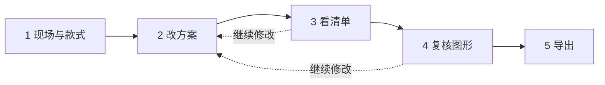

# aicad 用户流程

状态：**草案 v0.1（2026-11-19），待确认**。括号里的编号对应 [requirements.md](requirements.md)。

这里只写用户看到的流程。系统内部的计算链路在实现阶段另写架构说明。

## 1. 总览

第 2、3、4 步在同一个工作台里：改一个参数，清单和图形立刻跟着变。因为不再使用 CadQuery（D-009），检查、清单和预览都是即时计算，流程里没有“生成”这一步，也没有等待生成的状态。

## 2. 每一步

### 第 1 步：现场与款式（A1–A8）

- **进入条件**：打开工作台，还没有方案。如果导入已有的参数文件，直接进入第 2 步。
- **用户动作**：
  - 添加现场照片（可选）。
  - 让视觉 AI 估计场地大小和已有货架的型号（可选）。
  - 确认或改写场地尺寸，也可以直接手填。
  - 选定一个标准款。
- **系统反馈**：
  - 视觉给出的值标为“估计·待确认”。
  - 显示识别出的型号对应哪个标准款。
  - 显示所选标准款的默认尺寸、件数和造价。
- **离开条件**：已选定标准款。场地尺寸可以留空或保持未确认。

### 第 2 步：改方案（B1–B7）

- **进入条件**：已选定标准款。
- **用户动作**：修改尺寸、排列方式和连接方式；需要时修改起步高度等默认假设。
- **系统反馈**：
  - 每次修改后即时校验，错误定位到字段并用中文说明。
  - 与标准款不同的字段有标记。
- **离开条件**：没有。用户可以随时在第 2、3、4 步之间来回。

### 第 3 步：看清单（C3–C10）

- **进入条件**：参数通过校验。
- **用户动作**：查看清单，按属性筛选，查看某一行的判定原因。
- **系统反馈**：
  - **汇总**：总件数、非标件数、总造价及其中估算的部分、与标准款的差额。
  - **清单行**：类别、规格、属性及原因、SKU、件数、单价、小计、价格性质。
  - **变化提示**：修改参数后，发生变化的行有标记。
- **离开条件**：没有。

### 第 4 步：复核图形（D1–D3、B5）

- **进入条件**：参数通过校验。
- **用户动作**：旋转三维预览；查看正视、侧视、俯视三张带尺寸的二维图。
- **系统反馈**：
  - 图形与清单是同一个版本。
  - 俯视图上叠加场地轮廓，方案超出场地时提示超出的方向和数值。
- **离开条件**：没有。

### 第 5 步：导出（E1–E5）

- **进入条件**：参数没有错误。
- **用户动作**：选择要导出的内容，查看交付说明。
- **系统反馈**：
  - 清单、二维图和参数带同一个版本标识。
  - 交付说明列出默认假设、估算项、未确认的场地尺寸和超出场地的提示。
- **离开条件**：文件已下载。之后再修改参数，会产生新的版本标识。

## 3. 状态

### 方案级

| 状态 | 含义 | 界面表现 | 可以做什么 |
|---|---|---|---|
| 空 | 还没选定标准款 | 显示第 1 步 | 添加照片、选款式、导入参数 |
| 有效 | 参数通过校验 | 清单、预览和二维图都是当前版本 | 全部操作 |
| 有错误 | 至少一个参数没通过校验 | 错误字段有标记；清单和图形保留上一次有效的结果并标为“过期” | 修改参数；不能导出 |
| 已导出 | 当前版本已经导出过 | 显示版本标识和导出时间 | 全部操作；修改参数后回到“有效” |

### 字段级

只用于视觉可能给出的两个值：场地尺寸和货架型号。

| 状态 | 含义 |
|---|---|
| 空 | 没有值 |
| 估计·待确认 | 视觉给出，还没有人确认 |
| 已确认 | 视觉给出，已由人确认 |
| 手填 | 由人直接填写或改写 |

### 清单行级

| 维度 | 取值 |
|---|---|
| 属性 | 标准件、尺寸非标、形式非标 |
| 价格性质 | 目录价、估算·需询价 |

## 4. 异常路径

| 情况 | 系统怎么做 | 是否阻塞 |
|---|---|---|
| 没有配置视觉服务，或调用失败 | 说明原因，提示手工填写场地尺寸并选择款式 | 不阻塞 |
| 识别不出型号，或型号不在标准款里 | 说明情况，列出标准款供手选 | 不阻塞 |
| 场地尺寸未确认 | 场地对照不下结论；交付说明注明“场地尺寸未确认” | 不阻塞 |
| 参数错误 | 定位到字段并说明；保留上一次有效的清单并标为“过期” | 阻塞导出 |
| 方案超出场地 | 在俯视图上标出超出的部分 | 不阻塞，写入交付说明 |
| 导入的参数文件无法读取 | 报错，不覆盖当前方案 | 不影响当前方案 |
| 尺寸不在规格表里 | 这不是错误：对应的构件判为尺寸非标 | 不阻塞 |

## 5. 画面清单

原型按这张清单做，每个状态一张画面。

1. **项目介绍页**（F1）。
2. **开始页：现场与款式**
   - 空。
   - 视觉估计待确认。
   - 视觉服务不可用。
3. **工作台：参数、清单和图形同屏**
   - 有效，与标准款一致。
   - 有效，含非标件。
   - 有错误。
   - 超出场地。
4. **导出：内容选择与交付说明**
   - 可导出。
   - 已导出。

## 6. 需要确认的三个设计选择

1. **第 2、3、4 步同屏**：参数、清单和图形放在一个工作台里，而不是分成三个页面。
2. **出错时保留上一次有效的清单并标为“过期”**，而不是清空。
3. **场地尺寸未确认不阻塞导出**，只在交付说明里注明。
